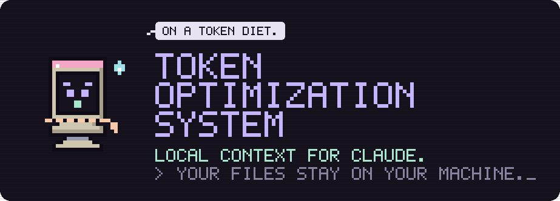

<p align="center">
  
</p>

<p align="center">
  
  
  
  
</p>

Token Optimization System is one repository with two parts.

- **Measure.** `python -m hive report` shows where the tokens of your Claude Code sessions went. It reads the session logs that Claude Code already keeps on your computer and writes nothing. See [Measure where your Claude Code tokens go](#measure-where-your-claude-code-tokens-go).
- **Retrieve.** A small MCP server for Claude Desktop that returns a few sections of your own files instead of whole documents. See [Retrieval server for Claude Desktop](#retrieval-server-for-claude-desktop).

Everything runs on your machine. There is no account, no telemetry and no network connection.

## Measure where your Claude Code tokens go

Claude Code writes a log of every session. The report adds up the tokens in those logs by source: tool definitions and system text, text that Claude Code injects, your prompts, thinking, tool inputs, tool results and images. Each token is priced by its type (new input, cache write, cache read, output) at the API price of the model that handled the call. A token that enters the context is read again by every later call, so each row has a "new" column, a "carried" column (the re-reads on later calls) and an "output" column. The aim is to see which source is large before you change anything.

### What you need

- Python 3.10 or newer.
- Claude Code's session logs, in `.claude\projects` (or `.config\claude\projects`) inside your home folder.
- Nothing to install: the package uses only Python's standard library. Download this repository as in [Install](#install) step 1 and run the commands from the folder that contains `README.md`.

The package is tested in CI on Windows and Linux, with Python 3.10 and 3.12. macOS has not been tried.

### First run

```powershell
python -m hive report
```

The first lines look like this. The numbers differ on every machine; `<n>` stands for a number and `<date>` for a date.

```text
Hive 0.1.0 report, read only
Period: sessions whose first record is dated <date> to <date> (last 28 days, UTC)
Sessions: <n> main, <n> subagent; counted calls <n> (calls repeated from an earlier file, not counted: <n>)
Weights: api-v2. Weighted cost is each token times the API price of its billing type for the call's model; it is not a bill, and on a subscription it stands in for plan usage.

By source: tokens by category (main and subagent sessions)
  shares are of the total of all rows below (raw <n> tokens, weighted $<n>)
  category / row            new    carried    output    raw total    raw %    weighted    w %
  prefix                    <n>        <n>        <n>          <n>    <n>%        $<n>   <n>%
  injected                  <n>        <n>        <n>          <n>    <n>%        $<n>   <n>%
  ...
```

After that come the compartments (the sources grouped, for example into agentic work and chat text), the cost by model, the cost by token kind, the median of the largest context per session, and checks (calls without a price, share of context no source accounts for).

The thinking table lists, for each model, the thinking tokens written as output, the cost of re-reading them in later calls ("later context"), and the total of the two. Use the total: on the author's machine thinking is 30.8% of the weighted cost, while the output column alone is 18.4%. Another table shows the effort levels found in the logs with calls and thinking tokens per call. Both name the most a lower level could remove, not a saving.

If no log is found, it prints one line and exits with code 1:

```text
No Claude Code session log found. Folders searched: <folder>, <folder>. Pass the log folder with --dir.
```

Options: `--dir <folder>` (repeatable) names the log folder, `--days <n>` sets the period (default 28), and `--names` adds project and MCP server names. With `--names` the first line of the output says that it holds local names.

### What the numbers are

Weighted cost is each token times the API price of its type for the model of that call. The prices are in `hive/weights/api-v2.json` with their source, the Anthropic pricing page. The dollar figures are not a bill. On a subscription they stand in for how fast plan usage is spent. Calls to a model without a price are left out of every weighted total and are counted under Checks.

The report does not say that any change saves tokens, and it changes nothing on your machine.

### Commands

| Command | What it does |
|---|---|
| `python -m hive report` | The tables above. Read only. |
| `python -m hive sense` | Keeps one row of numbers per session in the data folder (see [Privacy of the measurement part](#privacy-of-the-measurement-part)). A row stays after Claude Code deletes the log. |
| `python -m hive baseline` | Reads the rows of `sense`: days with sessions in the last 28 days, sessions that cross 04:00, how much the cost per typed prompt varies from day to day, and how often failed tool calls, interrupts, repeated reads and repeated commands occur. Run `sense` first. |
| `python -m hive replay bash-output-limit` | Replays the last 28 days as if Claude Code had cut each successful Bash or PowerShell result at 4,000, 8,000 or 15,000 characters (the setting `bashOutputMaxChars`). It prints the tokens that would have been saved, how often the cut-off part was named in a later step, and whether each limit passes. It is an estimate from the logs. No model call backs it, and it changes no setting. |

The package has more commands (`trial`, `tick`, `keep`, `suggest`, `record`, `share`, `validate`, `simulate`, `config`, `note`) for a loop that switches one Claude Code setting on and off on random days and judges the effect. The code is in this repository and is being tested on the author's machine. It is not released and is not documented here. `trial start` refuses to change a real Claude Code settings file unless the environment variable `HIVE_ALLOW_LIVE=1` is set.

Claude Code deletes session logs after 30 days by default (`cleanupPeriodDays` in its settings). `report` and `replay` read only the logs that still exist, so run `python -m hive sense` now and then to keep the numbers of older sessions.

### Privacy of the measurement part

- `report` reads the logs and writes nothing, not even the data folder. Without `--names` its output has no project name, path, command, MCP server name or session id, so it can be pasted into an issue.
- `sense` and the commands that keep data write to `%USERPROFILE%\.token-optimization-system\hive\`, or to the folder in the environment variable `HIVE_HOME`. The rows hold project names and session ids, and they stay in that folder.
- The package makes no network connection. To remove its data, delete the data folder.

## Retrieval server for Claude Desktop

The server indexes folders you choose on your own computer. When Claude needs something from those files, it asks the server, and the server returns the few sections that answer the question instead of whole documents. Claude reads less, so a conversation uses less of its context window and of your plan's usage.

The index is one SQLite file in the install folder. The server makes no network connection.

### Example

You ask Claude: *"What acceptance criteria did we set for the chunking experiment?"*

Claude calls `optimizer_context` with the question. The server returns two sections, about 1,500 tokens, each under a short file label, instead of whole files. How much that saves depends on how Claude would otherwise find the answer; see the measured result below.

### Measured result

One controlled test so far, run in Claude Code (not in Claude Desktop). It asked 20 questions about this project's own 39 Markdown notes and compared three setups: no server, the server available, and the server available with a one-line instruction to use it. Each question was answered once per setup, and Claude Code's own cost estimate was compared question by question. The rule for the verdict was written before the first run.

- With the server and the instruction, the estimated cost of the answers was 41% lower in total (0.24 against 0.41 dollars for the 20 questions). It was lower in 17 of the 19 questions that both setups answered correctly, and the median question cost 47% less.
- The median run put 31% fewer tokens into the context (about 11,000 against 16,000).
- Answers were correct in 19 of 20 runs with the server and in 20 of 20 without it. The one miss was a wording mismatch in the automatic check, not a missing section.
- Without the instruction, Claude still called the server in 18 of 20 runs.

What this does not show: the notes are 39 small files and the questions were written from them, so their wording overlaps closely with the text, which suits keyword search. Without the server, Claude Code searched with grep and read parts of files, which is a cheap baseline on small files. Results on large documents, in other clients or with your own questions can differ, in either direction. The raw data is not published.

After the test, in two weeks of real work in this project's folder (2026-10-28 to 2026-11-10), Claude Code did not call the server on its own in any of 21 sessions; in normal sessions Claude Code shows MCP tools by name only until it searches for them, while the test runs had the tool descriptions loaded from the start.

### Tools Claude gets

| Tool | What it does |
|---|---|
| `optimizer_context` | The main tool. Returns the most relevant sections for a question, at most `max_chunks` (default 2), in a compact format. Returns nothing when nothing matches well. |
| `optimizer_search` | Lists the best-matching sections with their file and heading. |
| `optimizer_read` | Returns one indexed section, chosen by file and heading. |
| `optimizer_stats` | Shows what is indexed and how many tokens were delivered compared with the full files. The percentage it prints is a local estimate of what whole files would have cost. It is not what Claude spends without the server (in the test above, Claude Code searched and read parts of files), so it is higher than the saving measured there. |

Supported files: Markdown, Word (.docx), PDF, PowerPoint (.pptx), Excel (.xlsx), plain text, CSV, JSON, YAML, HTML, CSS, Python, JavaScript and TypeScript. Markdown and Word files are split by heading, PDFs by page, presentations by slide and spreadsheets by sheet.

### Requirements

- Windows 10 or 11
- Python 3.10 or newer, from [python.org](https://www.python.org/downloads/)
- [Claude Desktop](https://claude.ai/download)

### Install

Each step shows the command to run and what you should see. If a step does not end as shown, stop there and read [Troubleshooting](#troubleshooting).

**1. Download this repository.**
Either click **Code > Download ZIP**, then right-click the file and choose **Extract All**. Or, with Git installed:

```powershell
git clone https://github.com/HEX-1000/token-optimization-system.git
```

**2. Open PowerShell in the downloaded folder.**
Open the folder in File Explorer (the one that contains `README.md`), click the address bar, type `powershell` and press Enter. Check that you are in the right place:

```powershell
dir README.md
```

You should see `README.md` listed.

**3. Install.**

```powershell
powershell -ExecutionPolicy Bypass -File scripts\install.ps1
```

This copies the program to `%USERPROFILE%\Programs\TokenOptimizationSystem`, creates a private Python environment there and installs its packages. It ends with `Installed. Next steps:`.

**4. Index a folder.** Replace the path with a folder of your documents:

```powershell
powershell -ExecutionPolicy Bypass -File scripts\index.ps1 -Folder "C:\Users\you\Documents\Notes"
```

It lists the files it reads and ends with a summary in which `Failed files:` is `0`. Repeat this step for every folder you want Claude to search.

**5. Quit Claude Desktop completely.** Right-click its icon in the system tray and choose **Quit**. Closing the window is not enough.

**6. Connect Claude Desktop.**

```powershell
powershell -ExecutionPolicy Bypass -File scripts\connect-claude-desktop.ps1
```

It makes a backup of Claude Desktop's config file, adds one entry named `token-optimization-system`, and ends with `Done.`

**7. Start Claude Desktop and test.** Under **Settings > Developer**, `token-optimization-system` should show as running. In a new chat, ask: *"Run optimizer_stats."* The answer starts with `Token Optimization System v0.25.2` and shows your file count.

**Tip:** Claude uses the tools when it thinks they help. To make that the default, add this to your project instructions in Claude: *"Before reading local files, call optimizer_context with the question. Read whole files only if the returned sections are not enough."*

#### Keeping the index current

Run step 4 again after files change. Only new or changed files are read again. Add `-Rebuild` to index a folder from scratch.

#### Update

Download the new version (or run `git pull` if you cloned it), quit Claude Desktop from the tray icon so the old server stops, and run step 3 again. The program files are replaced and your index is kept. Then start Claude Desktop; the first line of the `optimizer_stats` answer shows the version, and [CHANGELOG.md](CHANGELOG.md) lists what changed. Nothing checks for updates for you, because the server makes no network connections.

#### Uninstall

1. Quit Claude Desktop and run `powershell -ExecutionPolicy Bypass -File scripts\connect-claude-desktop.ps1 -Undo`.
2. Delete `%USERPROFILE%\Programs\TokenOptimizationSystem`. This also deletes the index.

#### Troubleshooting

| Message or symptom | What to do |
|---|---|
| `running scripts is disabled on this system` | Run the commands exactly as shown, including `-ExecutionPolicy Bypass`. Nothing else needs to change. |
| `Python 3.10 or newer was not found` | Install Python from python.org with **Add python.exe to PATH** ticked, open a new PowerShell window and repeat step 3. |
| `Claude Desktop is still running` | Quit it from the tray icon, not just the window. |
| `Several config files were found` | Run step 6 again with `-Config "<path>"`, using the most recently modified file from the list. |
| `Claude Desktop config not found` | In Claude Desktop open **Settings > Developer > Edit Config** once, quit Claude Desktop, and repeat step 6. |
| A tool answers with `no such table` | Nothing is indexed yet. Run step 4, then ask again. |
| The server shows as failed in Claude Desktop | Python from the Microsoft Store sometimes fails when another app starts it. Install Python from python.org and repeat step 3 with `-Python "<path to python.exe>"`. |

### Limitations

- Search is keyword based (SQLite FTS5 with BM25). It finds sections that share words with the question, not paraphrases. There are no embeddings yet.
- Queries are reduced to the letters a to z and digits, so words with other letters (ö, é, ß) do not match. English documents work best.
- Text files other than Markdown (.txt, .json, .py and so on) are stored as one piece, which can be large. Folders of Markdown, Word, PDF, PowerPoint or Excel files work best.
- Tables and speaker notes in Word and PowerPoint files are not extracted yet.
- The scripts are for Windows. The server is plain Python and may run elsewhere, but that is untested.
- Retrieval quality was measured on a small benchmark: 54 sections and 89 questions. Results on your files will differ.

### Privacy of the retrieval server

- Indexing reads only the folders you pass to `index.ps1`.
- The index is stored in `%USERPROFILE%\Programs\TokenOptimizationSystem\data\optimizer.db`.
- When Claude asks a question, the server reads only its own index. It does not open files on disk and makes no network connections.
- The sections the server returns become part of your conversation with Claude, like anything else you share with Claude. Index only what you would share.

### How it works

1. **Index.** Files are split into sections by structure and stored in a SQLite full-text index.
2. **Retrieve.** The question is matched against the index in several passes (all words, any word, word prefixes).
3. **Rank.** Candidates are scored on how much of the question they cover, heading matches, phrase matches and BM25 relevance.
4. **Select.** The best section is returned only if its score clears a fixed threshold; otherwise the server says nothing matched. Further sections are added only when they add new information.
5. **Return.** Selected sections go back to Claude in a compact format.

Details and the evaluation method: [docs/how-it-works.md](docs/how-it-works.md).

## Where this is going

This is free, open-source software, and it stays usable without contributing anything back. Every installation works alone, with its own logs and its own index.

The long-term plan is a privacy-safe way to learn from many installations. Users who opt in would share experiment results, such as a method, its settings and aggregate scores, never their documents, queries or file names. Improvements found on one machine could then be tested and released for everyone.

The first part of that is in the code: a loop that switches one Claude Code setting on and off on random days, compares the cost per prompt on the two kinds of day, and writes a record that holds numbers only. It runs on the author's machine now. When one full trial has finished there, the loop and the record form will be documented for other users. Until then this repository shares and sends nothing, and opt-in contribution does not exist.

## Versions

Current: **0.26.1**, which adds thinking and effort levels to the measurement report (`python -m hive report`). The retrieval server is 0.25.2 (retrieval V0.25.0 with compact output) and has not changed. See [CHANGELOG.md](CHANGELOG.md).

Development and experiments happen in a separate repository. Changes reach this one after they are measured on the evaluation suite. Bug reports are welcome as [issues](../../issues), questions and ideas in [Discussions](../../discussions). Both are public, so do not paste document text, file names or folder paths there. If you tried the server on your own files, the "Report a result" form asks for numbers and a general description. It never asks for document text, file names or your questions.

## License

[MIT](LICENSE). Made by [HEX-1000](https://github.com/HEX-1000).
