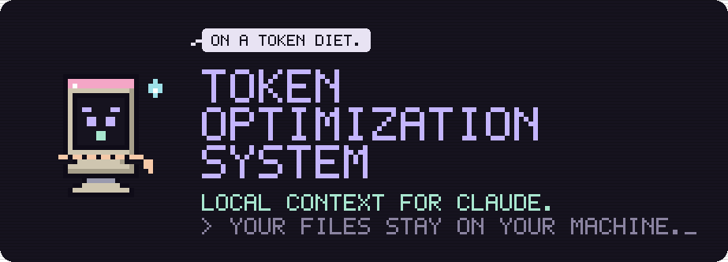

<p align="center">
  
</p>

<p align="center">
  
  
  
  
</p>

Token Optimization System is a small MCP server for Claude Desktop. It indexes folders you choose on your own computer. When Claude needs something from those files, it asks the server, and the server returns the few sections that answer the question instead of whole documents. Claude reads less, so a conversation uses less of its context window and of your plan's usage.

Everything runs on your machine. The index is one SQLite file in the install folder. There is no account, no telemetry and no network connection.

## Example

You ask Claude: *"What acceptance criteria did we set for the chunking experiment?"*

Claude calls `optimizer_context` with the question. The server returns two sections, about 1,500 tokens, each under a short file label. Without the server, Claude would open the records one by one: about 80,000 tokens for the same answer. That is one measured case on this project's own notes, not a benchmark.

## Tools Claude gets

| Tool | What it does |
|---|---|
| `optimizer_context` | The main tool. Returns the most relevant sections for a question, at most `max_chunks` (default 2), in a compact format. Returns nothing when nothing matches well. |
| `optimizer_search` | Lists the best-matching sections with their file and heading. |
| `optimizer_read` | Returns one indexed section, chosen by file and heading. |
| `optimizer_stats` | Shows what is indexed and how many tokens were delivered compared with the full files. |

Supported files: Markdown, Word (.docx), PDF, PowerPoint (.pptx), Excel (.xlsx), plain text, CSV, JSON, YAML, HTML, CSS, Python, JavaScript and TypeScript. Markdown and Word files are split by heading, PDFs by page, presentations by slide and spreadsheets by sheet.

## Requirements

- Windows 10 or 11
- Python 3.10 or newer, from [python.org](https://www.python.org/downloads/)
- [Claude Desktop](https://claude.ai/download)

## Install

Each step shows the command to run and what you should see. If a step does not end as shown, stop there and read [Troubleshooting](#troubleshooting).

**1. Download this repository.**
Either click **Code > Download ZIP**, then right-click the file and choose **Extract All**. Or, with Git installed:

```powershell
git clone https://github.com/HEX-1000/token-optimization-system.git
```

**2. Open PowerShell in the downloaded folder.**
Open the folder in File Explorer (the one that contains `README.md`), click the address bar, type `powershell` and press Enter. Check that you are in the right place:

```powershell
dir README.md
```

You should see `README.md` listed.

**3. Install.**

```powershell
powershell -ExecutionPolicy Bypass -File scripts\install.ps1
```

This copies the program to `%USERPROFILE%\Programs\TokenOptimizationSystem`, creates a private Python environment there and installs its packages. It ends with `Installed. Next steps:`.

**4. Index a folder.** Replace the path with a folder of your documents:

```powershell
powershell -ExecutionPolicy Bypass -File scripts\index.ps1 -Folder "C:\Users\you\Documents\Notes"
```

It lists the files it reads and ends with a summary in which `Failed files:` is `0`. Repeat this step for every folder you want Claude to search.

**5. Quit Claude Desktop completely.** Right-click its icon in the system tray and choose **Quit**. Closing the window is not enough.

**6. Connect Claude Desktop.**

```powershell
powershell -ExecutionPolicy Bypass -File scripts\connect-claude-desktop.ps1
```

It makes a backup of Claude Desktop's config file, adds one entry named `token-optimization-system`, and ends with `Done.`

**7. Start Claude Desktop and test.** Under **Settings > Developer**, `token-optimization-system` should show as running. In a new chat, ask: *"Run optimizer_stats."* The answer starts with `Token Optimization System v0.25.2` and shows your file count.

**Tip:** Claude uses the tools when it thinks they help. To make that the default, add this to your project instructions in Claude: *"Before reading local files, call optimizer_context with the question. Read whole files only if the returned sections are not enough."*

### Keeping the index current

Run step 4 again after files change. Only new or changed files are read again. Add `-Rebuild` to index a folder from scratch.

### Uninstall

1. Quit Claude Desktop and run `powershell -ExecutionPolicy Bypass -File scripts\connect-claude-desktop.ps1 -Undo`.
2. Delete `%USERPROFILE%\Programs\TokenOptimizationSystem`. This also deletes the index.

### Troubleshooting

| Message or symptom | What to do |
|---|---|
| `running scripts is disabled on this system` | Run the commands exactly as shown, including `-ExecutionPolicy Bypass`. Nothing else needs to change. |
| `Python 3.10 or newer was not found` | Install Python from python.org with **Add python.exe to PATH** ticked, open a new PowerShell window and repeat step 3. |
| `Claude Desktop is still running` | Quit it from the tray icon, not just the window. |
| `Several config files were found` | Run step 6 again with `-Config "<path>"`, using the most recently modified file from the list. |
| `Claude Desktop config not found` | In Claude Desktop open **Settings > Developer > Edit Config** once, quit Claude Desktop, and repeat step 6. |
| The server shows as failed in Claude Desktop | Python from the Microsoft Store sometimes fails when another app starts it. Install Python from python.org and repeat step 3 with `-Python "<path to python.exe>"`. |

## Limitations

- Search is keyword based (SQLite FTS5 with BM25). It finds sections that share words with the question, not paraphrases. There are no embeddings yet.
- Queries are reduced to the letters a to z and digits, so words with other letters (ö, é, ß) do not match. English documents work best.
- Text files other than Markdown (.txt, .json, .py and so on) are stored as one piece, which can be large. Folders of Markdown, Word, PDF, PowerPoint or Excel files work best.
- Tables and speaker notes in Word and PowerPoint files are not extracted yet.
- The scripts are for Windows. The server is plain Python and may run elsewhere, but that is untested.
- Retrieval quality was measured on a small benchmark: 54 sections and 89 questions. Results on your files will differ.

## Privacy

- Indexing reads only the folders you pass to `index.ps1`.
- The index is stored in `%USERPROFILE%\Programs\TokenOptimizationSystem\data\optimizer.db`.
- When Claude asks a question, the server reads only its own index. It does not open files on disk and makes no network connections.
- The sections the server returns become part of your conversation with Claude, like anything else you share with Claude. Index only what you would share.

## How it works

1. **Index.** Files are split into sections by structure and stored in a SQLite full-text index.
2. **Retrieve.** The question is matched against the index in several passes (all words, any word, word prefixes).
3. **Rank.** Candidates are scored on how much of the question they cover, heading matches, phrase matches and BM25 relevance.
4. **Select.** The best section is returned only if its score clears a fixed threshold; otherwise the server says nothing matched. Further sections are added only when they add new information.
5. **Return.** Selected sections go back to Claude in a compact format.

Details and the evaluation method: [docs/how-it-works.md](docs/how-it-works.md).

## Where this is going

This is free, open-source software, and it stays usable without contributing anything back. Every installation works alone, with its own index.

The long-term plan is a privacy-safe way to learn from many installations. Users who opt in would share experiment results, such as a method, its settings and aggregate scores, never their documents, queries or file names. Improvements found on one machine could then be tested and released for everyone. None of this exists yet. The current stage is a reliable local release; a release process, an experiment format and opt-in contribution come next, in that order.

## Versions

Current: **0.25.2**, retrieval V0.25.0 with compact output. See [CHANGELOG.md](CHANGELOG.md).

Development and experiments happen in a separate repository. Changes reach this one after they are measured on the evaluation suite. Bug reports and questions are welcome as [issues](../../issues). If you tried the server on your own files, the "Report a result" form asks for numbers and a general description. It never asks for document text, file names or your questions.

## License

[MIT](LICENSE). Made by [HEX-1000](https://github.com/HEX-1000).
